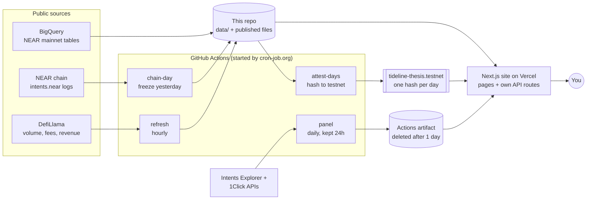

# Tideline

**Live site: [tideline-near.vercel.app](https://tideline-near.vercel.app)** · Research, not financial advice.

Tideline asks one question about NEAR: **how much NEAR Intents volume would it take for fee buybacks to cover the new NEAR being issued?**

It answers with a number you can check yourself, five readings on whether that number is getting closer, and a verdict that updates every day from public data. Every figure on the site can be recomputed from this repo with one command, without a key or an account.

Built at NEAR HACKATHON (November 2026) for the Investment Thesis track. All code and data were made during the hackathon window. The full argument, with today's figures, is in [THESIS.md](THESIS.md). The rules we wrote down before seeing the results are in [PREREG.md](PREREG.md).

## Why we built it

NEAR takes a share of the fees on every Intents swap and spends it buying NEAR on the open market. If those buybacks ever match the NEAR created each year, the supply stops growing. That's the bull case, and people quote a "volume needed" figure for it all the time.

When we went looking for that figure, we found one undated number with no method behind it. Nobody had published how volume reacts when fees change, which decides whether NEAR can raise revenue by pricing or only by growing. And public sources disagreed with each other.

So we built a threshold with a date and an interval, readings with rules fixed in advance, and a way for anyone to re-run all of it.

## Try it in five minutes

On the site:

1. **Open [Home](https://tideline-near.vercel.app/).** You see how many times today's monthly volume NEAR Intents would need, the five readings with their sides, and the verdict.
2. **Click Easy in the top bar.** The same page and numbers, in everyday words. Click Pro to go back.
3. **Open [Follow the Fee](https://tideline-near.vercel.app/follow-the-fee/).** You see where the cost of a swap goes: the solver's spread, the app's fee, NEAR's share. Click **Open the Query** to see the SQL or source behind the figures, on the Reproduce page.
4. **Open [Model](https://tideline-near.vercel.app/model/)** and move **NEAR Price** or **HSP-029 Issuance Schedule.** The threshold and the date it might be reached change as you move them.
5. **Open [Reproduce](https://tideline-near.vercel.app/reproduce/).** You see the commands below and the latest day anchored on NEAR testnet.

In a terminal (Node 24, no key, about a minute):

6. **Run `npm ci`, then `npm run verify`.** It recomputes every published number from the stored data and ends in `ALL OK`.
7. **Run `npm run attest:check -- 2026-11-03`.** It reads that day's hash from `tideline-thesis.testnet` and prints `MATCH` against the file in `data/chain/`.

Every page has an **Easy** and a **Pro** mode. Pro shows the full detail. Easy says the same thing in everyday words, with the same numbers, for readers new to crypto. Elasticity and Method are in the top bar; Concentration and What Would Move are linked from Home and from Method.

## How it works



1. **Every day, a job freezes yesterday's chain data** from the `intents.near` contract into a file in `data/chain/`, and only commits it after `npm run verify` passes.
2. **A second job writes that file's hash to a small NEAR testnet contract.** A record can be written once and never changed, so anyone can check later that a day wasn't edited.
3. **Every hour, a job pulls DefiLlama's volume, fees and revenue**, recomputes the readings and the threshold, and regenerates THESIS.md.
4. **The site reads the published files** through its own API routes. Your browser only ever talks to the site, never to GitHub or any data provider directly.

### The five readings

Each reading has a Bullish, Neutral and Bearish line, written into PREREG.md before the results came in.

| Reading | The question it asks |
| --- | --- |
| Pricing Power | When fees go up, does volume stay? |
| NEAR's Share of Fees | How much of each fee does NEAR actually keep? |
| Solver Competition | Are many solvers competing, or a few? |
| Largest Integrator | How much depends on one app? |
| Path to Deflation | Is revenue growing toward the threshold? |

The verdict is the sum of the five. One rule overrides it, explained next.

## The part we can't see

Since 27 Oct 2026, a growing share of Intents swaps settles privately. Funds go to the Confidential Intents treasury, the swap happens out of public view, and funds come back. On chain, that treasury looks like the biggest solver by far. It isn't one: it's a bridge, so we never count it as a solver.

This changes what public data can say, so we wrote rules for it:

- **Solver Competition reads Not Measured** while the treasury carries more than half of the USD we can count.
- **While it does, the verdict is held at Undecided**, whatever the score. A loss of data shouldn't be able to move the answer.
- **A drop in public numbers is never read as a drop in demand.** It may just be volume moving out of sight.

What we can't see at all: fees on private swaps, which solver filled them, and any flow that stays shielded.

## The rolling panel, and why it's separate

The track asks for swap data from the NEAR Intents Explorer API. Its terms ([1ClickSwap API Terms of Use](https://partners.near-intents.org/legal/terms-of-service), section 4.1(e)) don't allow keeping that data for more than 24 hours. A re-runnable thesis has to keep its inputs, so the two can't mix.

So the Explorer and 1Click data appear only in a **rolling panel** on Follow the Fee and Concentration. One job pulls the last 30 days once a day and saves only totals, as a GitHub Actions artifact that's deleted after a day. Nothing from these APIs is in git, `data/`, the published files, a log or a message, and the panel never sets a reading. If it's over 24 hours old, the site says "Not Available". Intents Technology provides these APIs as a technology provider; nothing here is endorsed by it.

`EXPLORER_PANEL=off` removes the panel and its job, and the site still passes every test. More in [docs/EXPLORER.md](docs/EXPLORER.md).

## Check it yourself

You need Node 24. No key, no account, about a minute.

```bash
npm ci
```

```bash
npm run verify
```

`verify` recomputes every published number from the stored data and compares it with the committed files. It ends in `ALL OK`.

```bash
npm run attest:check -- 2026-11-03
```

This compares one frozen day with the hash written for it on NEAR testnet.

```bash
npm run rebuild
```

This recomputes every chart from stored public data.

```bash
npm run rebuild -- --bigquery
```

This re-runs the SQL in [queries/](queries/) with your own Google project (set `GOOGLE_PROJECT` and `GOOGLE_ACCESS_TOKEN`). It dry-runs each query first and refuses anything over 30 GB. The log read is about 818 GB of the free tier's 1 TB a month, so it only runs with `--read --max-gb 900`. Read [queries/README.md](queries/README.md) first.

```bash
npm run panel
```

This prints the rolling panel using your own `INTENTS_EXPLORER_JWT` (from the NEAR Intents partner dashboard), and writes nothing to the repo. Without one it stops with "INTENTS_EXPLORER_JWT is missing". That is expected: the panel only sits beside the thesis and sets no reading, and every reading re-runs without a key through `npm run verify`.

```bash
npx next dev -p 3112
```

This runs the site locally.

Prefer not to install anything? The Reproduce page has an "Open in Codespaces" button. It opens this repo in your browser with everything installed, so you only type `npm run verify`. It runs on your own GitHub account, free within GitHub's monthly Codespaces hours.

## Data sources

| What | Where it comes from | Kept in the repo? |
| --- | --- | --- |
| A year of frontends, fees and solvers, for elasticity | BigQuery `crypto_near_mainnet_us` and chain data | Yes, `data/bigquery/`, `data/chain/` |
| Treasury flow and the private share | `intents.near` dip4 logs (FastNEAR, NEAR RPC) | Yes, `data/treasury/` |
| Volume, fees, revenue, prices | DefiLlama | Yes, `data/snapshot/`, `data/published/` |
| Active accounts, transactions, contract use | BigQuery | Yes, `data/bigquery/` |
| Frontends and fees since 27 Oct | Intents Explorer API | **No. Rolling panel only** |
| Current quote breakdown | 1Click dry quotes | **No. Rolling panel only** |

## What updates on its own

Every job runs in GitHub Actions, started by cron-job.org ([docs/CRON.md](docs/CRON.md)), and only commits after `npm run verify` passes.

| Job | When (WIB, UTC+7) | What it does |
| --- | --- | --- |
| `refresh` | every hour | DefiLlama volume, fees and revenue, NEAR price and supply, the protocol fee, then every published file and THESIS.md |
| `chain-day` | daily, 10:17 | Freezes yesterday's chain day and treasury file |
| `attest-days` | daily, 12:41 | Writes each frozen day's hash to NEAR testnet |
| `panel` | daily, 09:07 | The rolling panel (a one-day artifact, never committed) |
| `activity` | Saturdays, 11:41 | Re-runs the two BigQuery activity queries for the last 90 days |
| `weekly-note` | Mondays, 08:00 | A short note to the [@tideline_thesis](https://t.me/tideline_thesis) Telegram channel |

Some things are fixed on purpose: the year of fee-change history before 3 Oct 2026 (one BigQuery read, frozen by PREREG.md amendment A4) and the pre-registered lines.

## NEAR tech used

- **NEAR Intents:** the whole thesis is about it. Swaps, fees and solvers are read from the `intents.near` contract's logs.
- **NEAR testnet contract:** `contract/` is a small Rust contract (cargo-near), deployed as `tideline-thesis.testnet`. It stores one write-once hash per frozen day. Records written from 8 Nov 2026 also carry the hash of that day's treasury file; earlier ones can't gain it, because a record is never changed. Testnet only, no funds. Details in `contract/deployment.json`.
- **NEAR RPC and FastNEAR:** chain reads for the treasury flow and for checking the hashes.
- **Intents Explorer and 1Click APIs:** the rolling panel only, as above.

## Stack, libraries and AI use

- **Site:** Next.js 16 (App Router), React 19 and TypeScript, hosted on Vercel. Fonts: Inter and Overpass Mono through `next/font`. The visual style (pale blue glass look) and the glass sphere, both the video and its still image in `public/media/`, come from a free template on [motionsites.ai](https://motionsites.ai/). The pages, charts, data and text are our own. No UI kit.
- **Analysis:** plain Node 24 with no npm packages beyond the site's own; data is stored as gzip CSV and JSON, so checking it needs nothing beyond `npm ci`.
- **Contract:** Rust with `near-sdk` 5.30, built with `cargo-near`; tests use `near-workspaces`, `tokio`, `anyhow` and `serde_json`.
- **Schedule and alerts:** GitHub Actions started by cron-job.org; Telegram for alerts and the public channel.
- **AI use:** the code, queries and docs were written with Claude Code (Anthropic), working with the team, who set the question, chose the data and the rules in PREREG.md, and reviewed every claim.

## For machines

- `GET /api/thesis.json`: the verdict, readings, threshold and text, as published.
- `GET /api/days`: every frozen chain day with its size and SHA-256.
- `GET /api/days/<YYYY-MM-DD>`: one frozen day, byte for byte.
- `GET /api/attest/<YYYY-MM-DD>`: that day's hash on testnet against the file.
- `GET /api/status`: last frozen day, freshness, and the hash of the published numbers.

No route serves the panel. Published files are in `data/published/`, each with its `source` and `query`. Rules for coding agents are in [AGENTS.md](AGENTS.md).

## Limits

- **The test isn't blind.** PREREG.md says what we already knew when each rule was written.
- **Elasticity is underpowered.** The interval is too wide to call a side yet.
- **DefiLlama can't be re-run for free,** so its figures are stored as evidence, not recomputed. How it counts private volume isn't known.
- **A re-run from scratch matches a frozen day's counts, not always its hash,** because DefiLlama can serve slightly different hourly prices later.
- **History starts on 1 Oct 2025,** set by the free BigQuery tier.
- **"Active accounts" counts transaction signers,** mostly relayers and solvers, not people.

## Team

Built by **Laras Ervintyana** ([@ervhint](https://github.com/ervhint)).

MIT licence.
