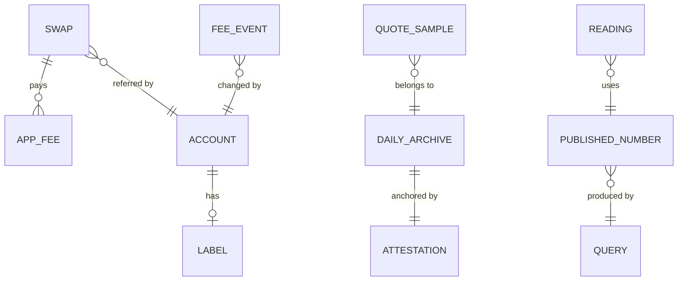

# Tideline: SRS

Status: G1 passed 30 Oct 2026. G2 passed 30 Oct 2026.

Data sources changed on 4 Nov 2026: the stored record uses only public chain data and keyless sources (docs/PLAN.md §1 to §4), and the Explorer and 1Click APIs feed only the rolling panel (docs/EXPLORER.md). Decisions and criteria below that use the Explorer API or a 1Click quote archive (D2, D6, D17, D19 to D22, U1 and U2 sampler and pull steps) are replaced by the plan; where this file and the plan differ, the plan wins.

## 1. Context and golden path

### 1.1 Problem

NEAR's investment case runs through one flow: Intents volume x fee rate x NEAR's capture = revenue, which funds NEAR buybacks against issuance. Volume, fees and revenue are public. How volume responds when the fee moves is not published anywhere we could find, and it decides whether NEAR can grow revenue by pricing or only by volume.

### 1.2 Users

House of Stake delegates, NEAR holders and funds modelling the token, integrators setting an app fee, solvers.

### 1.3 Facts checked on 30 Oct 2026

| Fact | Value | Source | Effect on the draft |
| --- | --- | --- | --- |
| Total supply | 1,310.34M NEAR | RPC `block` header | Confirms the draft's ~1.31B |
| NEAR price | $4.34 (draft: $4.97) | CoinGecko | Every dollar threshold moves with price |
| Last 30 days | Volume $3.89B, fees $5.97M (15.3 bps), revenue $2.16M (5.55 bps, 36%) | DefiLlama | Confirms the draft's fee and capture |
| V* at 1.6%, gross of gas, all revenue spent on buybacks | ~$13.7B/month (~$449M/day), 3.5x today | Computed | Draft said $15.8B |
| V* at 2.5%, same basis | ~$21.4B/month (~$702M/day), 5.5x today | Computed | Draft said $24.6B |
| HSP-029 vote | Closes 2 Nov 2026; 24-month phase-in after a ~90-day buffer | Secondary news only | The "live vote" hook expires before submission; 1.6% only arrives around early 2029 |
| Published threshold | ~$177M/day, in an article dated Apr 2026 with NEAR at $1.35; method not shown | TronWeekly, attributed to a DefiLlama Pro page (403) | Stale; we can explain the gap, mostly price |
| What "revenue" contains | Includes quote improvement (positive slippage), private agreements and buyback-wallet flows, measured when swept | DefiLlama methodology | Revenue is not strictly a share of fees, so `R = V*f*c` is an accounting identity, not a mechanism. Daily capture is meaningless; on 29 Oct revenue was above fees |
| RPC history | `rpc.mainnet.near.org` has no block 20M back; ~1.7 blocks/s means ~36M blocks since the fee switch | RPC | A full RPC backfill is not realistic; RPC becomes spot-check truth on sampled days |
| Flipside | `flipsidecrypto.xyz` and its docs host did not resolve from this machine; no shutdown news found | curl, search | Unconfirmed outage; not relied on |
| Dune | No longer free: free accounts are view-only with no API. New accounts get one 14-day trial with 2,500 credits | Dune docs | Judges can't re-run Dune queries for free, so Dune can't be the main source. Trial kept as a fallback; start its clock only when needed |
| Intents Explorer API | Per-swap history with USD amounts, `appFees`, `referral`, `status`; filters by time and affiliate; up to 1,000 swaps per request, 1 request per 5s; needs a JWT from partners.near-intents.org | OpenAPI spec | Becomes the main history source. Not yet tested: history depth, whether the JWT is free, share of all Intents volume (1Click only). No solver fields |
| Archived blocks | `neardata` serves blocks 30M back, ~162 KB each, and rate-limits bursts (429 after ~20 parallel requests) | Test run | Full history would be ~5.8 TB, so solver data comes from sampled days only |
| Method paper | Zhang, [arXiv 2607.21955](https://arxiv.org/abs/2607.21955) (read 30 Oct). Studies CoW Protocol, gives no fee elasticity. Its own fee-cut test was underpowered. Its p = 0.042 is the lowest possible with 4 buckets. Dropping the largest solver erased its aggregate result. [Replication code](https://github.com/ryonzhang/solver-reward-market-structure) is public | arXiv | We copy the design, and we may be the first to estimate elasticity. Report the p-value floor plainly; expect an underpowered result as a real possibility |
| 1Click | Reachable, ~20s per response. Test quote returned 400 (invalid test recipient) | curl | A valid quote still has to be confirmed; 5-minute grid sampling is likely too heavy |
| Per-integrator data on DefiLlama | None, chain-level total only | API | Event census must come from Dune or chain data |
| Research folder | `research/FINDINGS.md` and `judging*/` are not on this machine | Search | Draft's prelim numbers can't be traced; all get recomputed anyway |

### 1.4 Differentiator (from the novelty check)

Nobody has published how Intents volume responds to fee changes. Tideline turns a repeated, undated threshold figure into a falsifiable, re-runnable one with an elasticity band and a date path.

Closest prior work:

| Prior work | Closeness | What we add |
| --- | --- | --- |
| [DefiLlama Pro "NEAR revenue streams"](https://defillama.com/pro/near-revenue-streams-jjx5g0) (403, seen via citations) | 3/5, threshold only | Dated threshold, elasticity, `verify` |
| [SVRN NEAR research](https://svrn.net/research/near-protocol) (stub only, may hold a number we could not see) | 3/5, unverified | Re-runnable code, pre-registered readings |
| [Phemex: NEAR Intents swap fees](https://phemex.com/academy/near-intents-explained-swap-fees) (search summary only) | 2/5 | Event studies, not a descriptive take rate |

### 1.5 Golden path (proposed, 90 seconds)

1. Open the headline: the V* band, today's distance from it, and five readings with their sides.
2. Open Follow the fee: $100 of user cost split into solver spread, app fee, NEAR revenue and buyback.
3. Open Elasticity: the fee-event chart with interval, placebo band and minimum detectable effect, or the plain statement that it is underpowered.
4. Open Model: set issuance to the HSP-029 schedule, move price and elasticity, watch V* and its date change.
5. Terminal: `npm run verify` ends in `ALL OK`.
6. Terminal: `npm run attest:check` matches the archived quote file against the on-chain hash.

Wow moment: step 4 into 5. A delegate moves one slider, then a judge re-derives the same number from public data with one command.

### 1.6 Criteria mapping

The thesis track says it is "judged on the evidence, not the conviction". No scoring rubric is published. Claude Code and Codex screen first (Q-017).

| Feature | Serves |
| --- | --- |
| `npm run verify`, query links on every number | "Models anyone can re-run"; AI reproducibility screen |
| Fee trace, concentration, threshold | "Onchain analytics" |
| Live site, daily readings, side-change alarm | "Live dashboards" |
| Pre-registered two-sided readings, reconciliation of conflicting public figures | Evidence over conviction |
| Attest contract | NEAR integration; tamper-evident sampled data |
| Do-X-see-Y README | AI screen |

### 1.7 Scope (proposed, pending G1)

- **Must:** quote sampler and archive; Explorer API history with RPC spot checks; account labels with evidence links; fee trace; concentration; event census and E1 with MDE; threshold model; Headline, Follow the fee, Elasticity, Model pages; `verify`; attest contract; `PREREG.md`.
- **Should:** Concentration page; "What would move each reading" page; Method page; daily job with `alarm/history.json`; Telegram alarm; reconciliation table of conflicting public figures; feeds.
- **Could:** control venues beyond CoW; coverage board. (The X alarm was dropped on 3 Nov 2026 by the human; alarms go to Telegram only.)
- **Won't:** a token, trading or execution, wallet connect, accounts, mainnet transactions without explicit confirmation, personalized advice (the site states it is research, not financial advice).

### 1.8 Decisions from G1 (30 Oct 2026)

| # | Decision |
| --- | --- |
| D1 | Headline is V* as a dated path under both HSP-029 outcomes, with price as an explicit input. No "live vote" pitch |
| D2 | Run an event census on the Explorer API in P2. With fewer than 3 usable events, E1 stays and says "underpowered" with its MDE; the fee trace and threshold lead |
| D3 | Scope as in §1.7 |
| D4 | Attest contract on testnet. Reconsider mainnet at G5 only if the user asks |
| D5 | Replaced by D24. Was: Next.js static export on Vercel, GitHub Actions for jobs, data files in the repo, no Supabase |
| D6 | Quote sampler starts right after G1, every 30 minutes, 4 pairs x 4 sizes, in a public repo (user approved going public early) |
| D7 | The coding agent does engineering and analysis under human review at each gate. A separate reviewer checks the statistics in P5. Every number gets a plain-language line |
| D8 | Repo name `tideline`. The folder stays in OneDrive, so no git worktrees or parallel writers on this project |
| D9 | Tideline is the only entry. Every number is recomputed from source |
| D10 | SVRN outreach is optional and happens only once we have a real number |
| D11 | The agent generates the demo video in P6 from the demo script: start from the `hyperframes` skill (it routes to the right workflow), with real screen and terminal captures and an ElevenLabs voiceover (key only in gitignored `.env`). The human reviews it and publishes the X post |
| D12 | Focus on Tideline only; no other idea is being entered |

What is real in the demo: all of it. There are no assets, no user funds and no sign-in. Only the daily hash and readings go on-chain, written by one owner key that can't move anything of value. No AI features in the product.

### 1.9 Open questions

- Telegram bot, only if the Telegram alarm gets built.

## 2. Users and roles

| Role | Wants | Touches |
| --- | --- | --- |
| Delegate or holder | Where the thesis stands, how far V* is | Site, read-only |
| Judge or AI screener | To re-derive every number | README, `npm run verify`, `attest:check` |
| Integrator or solver | Fee and concentration data | Site, JSON feeds |
| Maintainer | Keep data flowing | GitHub Actions, owner key of the testnet contract |

There are no accounts, no sign-in and no wallet connect on the site.

## 3. Functional requirements

| ID | Requirement | Priority |
| --- | --- | --- |
| FR-01 | Sample dry quotes every 30 min on 4 pairs x 4 sizes; keep the raw signed response and a Binance reference price | Must |
| FR-02 | Hash each finished day's archive and anchor it, with the readings, in a testnet contract; `npm run attest:check <day>` compares them | Must |
| FR-03 | Pull per-swap history from the Explorer API into a snapshot committed to the repo; report its coverage against DefiLlama volume | Must |
| FR-04 | Label accounts (frontends, solvers, revenue wallets), each with an evidence link; rerun results with uncertain labels dropped | Must |
| FR-05 | Split the all-in cost of a swap into solver spread, app fee, protocol fee, NEAR revenue and buyback, by route and size | Must |
| FR-06 | Find dated fee changes from fee rates alone and freeze the event list in `PREREG.md` before any volume response is looked at | Must |
| FR-07 | Estimate E1 elasticity with interval, placebo dates, minimum detectable effect and a drop-the-largest check; say "underpowered" first when it is | Must |
| FR-08 | Estimate E2 pass-through from on-chain fills against historical reference prices | Must |
| FR-09 | Measure integrator share and solver concentration (HHI, top-3) in the buckets $0-1k, $1k-10k, $10k-100k, $100k+ | Must |
| FR-10 | Solve V* as a dated path under both HSP-029 outcomes, with price, fee, capture, buyback share and gas burn as inputs, across the E1 interval | Must |
| FR-11 | Model page with sliders recomputing V*, its date and the revenue-maximizing fee in the browser | Must |
| FR-12 | Compute readings Q1-Q5 and the verdict against pre-registered thresholds; publish `thesis.json` | Must |
| FR-13 | Headline, Follow the fee and Elasticity pages, with a query link and plain-language line for every number | Must |
| FR-14 | `npm run verify` recomputes every published number from the snapshot and prints `OK` or a diff per number; `--full` re-pulls from source | Must |
| FR-15 | Thesis text with the conclusion written last and a not-financial-advice statement | Must |
| FR-16 | Daily job recomputes readings and appends side changes to `alarm/history.json` | Should |
| FR-17 | Telegram alarm on a side change | Should |
| FR-18 | Reconciliation table of conflicting public figures (buyback share, cumulative volume) | Should |
| FR-19 | Concentration, What would move each reading, and Method pages | Should |
| FR-20 | `/api/thesis.json` and `/api/days/` feeds | Should |
| FR-21 | Coverage board of unquoted tokens; extra control venues (X alarm dropped 3 Nov 2026: Telegram only). Built 3 Nov 2026: board on /method/ from `data/snapshot/tokens`; controls 1inch, 0x, KyberSwap, LI.FI beside CoW | Could |

## 4. Non-functional requirements

- NFR-1: `npm i && npm run verify` finishes in under 10 minutes on a laptop, with no paid key and no secret.
- NFR-2: `--full` needs only free credentials, listed in `.env.example`.
- NFR-3: Golden-path pages load in under 2s on 4G and work at 375px.
- NFR-4: Text contrast is at least 4.5:1.
- NFR-5: The site stays up through 25 Nov 2026.
- NFR-6: A failed sampling run leaves a visible gap, never invented data. Charts show gaps.
- NFR-7: No secrets in the repo; `.env` is gitignored.

## 5. Data entities

Everything is a file in the repo: gzip CSV snapshots, JSONL archives, JSON outputs. There is no database.

## 6. Units

Order: U0 → U1 → U2 → U3 → U4 → U5 → U6 → U7 → Shoulds. Golden path: U0, U3, U4, U5, U6, U7, U1.

### U0 — Skeleton and deploy (Must · demo-critical)
Covers: NFR-3, NFR-7. Depends on: nothing. Est: 2h
- AC-0.1 Given a push to `main`, when Vercel builds, then a static site with all planned routes is live.
- AC-0.2 Given a fresh clone, when `npm i && npm run verify` runs, then the harness exits 0 and reports its number count.
Tests: T-0.1 (e2e), T-0.2 (cli)

### U1 — Quote archive and attest contract (Must · demo-critical)
Covers: FR-01, FR-02. Depends on: U0. Est: 6h. Sampler already live.
- AC-1.1 Given a scheduled run, when it finishes, then raw signed quotes are committed; a failed quote is recorded as failed.
- AC-1.2 Given a finished day, when the job runs, then its SHA-256 is stored on the testnet contract once.
- AC-1.3 Given that day's file, when `attest:check` runs, then it prints a match; given one changed byte, it prints a mismatch.
- AC-1.4 Given an already anchored day or a non-owner caller, when `attest` is called, then it fails and the state is unchanged.
Tests: T-1.1 (cli), T-1.2 (integration), T-1.3 (cli), T-1.4 (contract), plus invariant tests INV-1 to INV-3

### U2 — History snapshot and coverage (Must)
Covers: FR-03, FR-04. Depends on: U0. Est: 6h
- AC-2.1 Given a date range, when the pull runs, then every swap in it is in the snapshot, and a re-run adds no duplicates.
- AC-2.2 Given the snapshot, when compared with DefiLlama, then daily coverage is published, including the days that disagree.
- AC-2.3 Given three sampled days, when compared with chain data, then differences are published in a reconciliation table.
- AC-2.4 Given any label, when it is read, then it has an evidence link.
Tests: T-2.1 (integration), T-2.2 (unit), T-2.3 (integration), T-2.4 (unit)

### U3 — Follow the fee (Must · demo-critical)
Covers: FR-05, FR-13. Depends on: U1, U2. Est: 6h
- AC-3.1 Given a route and size, when the page renders, then the cost parts sum to the all-in cost within 0.5 bps, and any remainder is shown as "unexplained".
- AC-3.2 Given a number on the page, when opened, then its query and plain-language line are visible.
- AC-3.3 Given the day-1 fee account check, when finished, then whether `5880ad2b…47dd` is a revenue account is stated with evidence.
Tests: T-3.1 (e2e golden), T-3.2 (e2e), T-3.3 (unit)

### U4 — Threshold model (Must · demo-critical)
Covers: FR-10, FR-11. Depends on: U2. Est: 6h
- AC-4.1 Given issuance, price, fee, capture, buyback share and gas burn, when solved, then V* matches a hand-worked fixture.
- AC-4.2 Given the HSP-029 schedule, when solved, then V* appears as a dated path, with the failed-vote path beside it.
- AC-4.3 Given a slider move, when released, then V* and its date update within 100ms.
- AC-4.4 Given `npm run model -- --issuance 1.6`, when run, then V* prints with its interval.
Tests: T-4.1 (unit), T-4.2 (unit), T-4.3 (e2e golden), T-4.4 (cli)

### U5 — Elasticity and pass-through (Must · demo-critical)
Covers: FR-06, FR-07, FR-08, FR-13. Depends on: U2. Est: 10h
- AC-5.1 Given `PREREG.md`, when git history is read, then the event list and estimands were committed before the estimation code.
- AC-5.2 Given the events, when estimated, then interval, placebo distribution, MDE and the drop-the-largest result are all published.
- AC-5.3 Given an interval spanning zero or an MDE above the estimate, when the page renders, then its first line says "underpowered".
- AC-5.4 Given fewer than 3 usable events, when the page renders, then it states that count and the fee trace and threshold stay the lead (D2).
Tests: T-5.1 (cli), T-5.2 (unit, on synthetic data with a known effect), T-5.3 (e2e golden), T-5.4 (e2e)

### U6 — Readings and Headline (Must · demo-critical)
Covers: FR-09, FR-12, FR-13, FR-15. Depends on: U3, U4, U5. Est: 6h
- AC-6.1 Given a metric at, above or below a threshold, when computed, then its side matches `PREREG.md`, tested on each boundary.
- AC-6.2 Given the buckets, when computed, then HHI and top-3 match a hand-worked fixture.
- AC-6.3 Given the Headline page, when opened, then the V* band, five readings and verdict are visible with no scrolling at 1440px.
Tests: T-6.1 (unit), T-6.2 (unit), T-6.3 (e2e golden)

### U7 — Verify (Must · demo-critical)
Covers: FR-14, NFR-1, NFR-2. Depends on: U3, U4, U5, U6. Est: 4h
- AC-7.1 Given a fresh clone with no `.env`, when `npm run verify` runs, then every published number prints `OK` and it ends in `ALL OK` in under 10 minutes.
- AC-7.2 Given one edited published number, when it runs, then it prints that number's diff and exits non-zero.
Tests: T-7.1 (cli golden), T-7.2 (cli)

### U8 — Daily job and alarm (Should)
Covers: FR-16, FR-17. Depends on: U6. Est: 3h
- AC-8.1 Given a reading that changes side, when the job runs, then one entry is added to `alarm/history.json` and one Telegram message is sent.
- AC-8.2 Given no change, when the job runs, then nothing is added or sent.
Tests: T-8.1 (unit), T-8.2 (unit)

### U9 — Remaining pages, feeds and reconciliation (Should)
Covers: FR-18, FR-19, FR-20. Depends on: U6. Est: 4h
- AC-9.1 Given each conflicting public figure, when the table renders, then every source, its value, its date and our computed value are shown.
- AC-9.2 Given `/api/thesis.json`, when fetched, then it matches the Headline page.
Tests: T-9.1 (e2e), T-9.2 (e2e)

## 7. Decisions log

D1-D12 are in §1.8.

| # | Decision |
| --- | --- |
| D13 | The Explorer API is the main history source, because anyone can get free access and re-run it. Dune is a fallback only |
| D14 | Control venues use free DefiLlama daily volume (CoW Swap, confirmed: 1,051 days) plus unaffected integrators; no paid Dune. UniswapX on DefiLlama is not found yet, so it is a Could. 3 Nov 2026: UniswapX still has no DefiLlama entry and the Uniswap aggregator starts 2026-05-31; 1inch, 0x, KyberSwap and LI.FI (full history from Aug 2025) were added as controls |
| D15 | Analysis runs in Node only, with data as gzip CSV and JSON, so a judge needs nothing beyond `npm i` |
| D16 | Inference is design-based (permutation and placebo dates), as in the method paper, which treats model-based p-values as too optimistic |
| D17 | The sampler stays without a JWT, because a JWT removes the 20 bps default fee and we measure what a default user pays |
| D18 | `to-spec` and `to-tickets` are not installed, so this SRS was written directly in their format |

| D19 | First event census (30 Oct): one page of up to 1,000 swaps per day, 424 days from 1 Sep 2025, reading fee rates only. It found 30 raw step changes across about a dozen frontends, including raises and cuts at sweat-app, lifi, rhea, meteor, swapkit, consumerfi, hvlnear, intents.tg and NEAR's own frontend. Output: `data/census/fee-events-sample-2026-10-30.json`. Not final: some rows are the same change seen twice, and the list gets rebuilt from the full pull and frozen in `PREREG.md` before any volume is read. Whether each event has enough volume to measure is still unknown |
| D20 | Explorer API confirmed working: history reaches at least Jun 2025, about 14,000 swaps on a busy day, paging tested on one day. Replaced on 4 Nov 2026: no Explorer data is pulled or stored (PLAN §1) |
| D21 | Coverage checked (31 Oct): the Explorer has 7.26M swaps on 424 days and holds about 38% of DefiLlama's volume (25% to 53% by month, 27% in Oct 2026). The docs describe the Explorer as 1Click history, so this looks like a difference in scope, not a failed pull. DefiLlama's figure comes from a Dune dataset whose contents we can't see. So V* and "today" use DefiLlama, and elasticity, integrator share and fee events use the Explorer, labelled "1Click only" |
| D22 | `PREREG.md` is frozen before U3, because every per-frontend volume file must come after it |
| D23 | Tests use `node --test` instead of Vitest, following D15 |
| D24 | Workflow V7 (31 Oct), and the human wants the data kept up to date. The browser talks only to a Next.js BFF, which reads the published files from GitHub, so new data shows without a redeploy. A job refreshes hourly, though GitHub's schedule can run hours late. Each finished UTC day is frozen, committed to `data/` and anchored, and only frozen days count as evidence. Raw swaps go in a separate private GitHub repo. `npm run verify` needs no key. No Supabase for now (the human's decision, 1 Nov): the app has no logins or user data, and one copy of the numbers is easier to trust. If reading from GitHub fails in testing, add Supabase behind `lib/data.ts` |

## 8. Open questions

- What the other ~62% of DefiLlama's volume is (non-1Click flow, or double counting). The chain spot checks in AC-2.3 should show this.
- Explorer holes: no swaps for about 10 hours on 2025-10-06 and about 14 hours across 2026-04-16 and 17. Service outage or missing data is unknown. Event windows must not silently span them.
- Primary source for HSP-029 and the fee switch, checked in U2. The vote result is due 2 Nov.

## 9. Web3 sections

### 9.1 Asset flows

Tideline moves no asset. The flow it measures: the user pays the all-in cost; the solver keeps the spread; the frontend or integrator collects the app fee; the protocol collects its fee; part reaches NEAR revenue wallets; revenue funds buybacks. Where bought NEAR goes is a day-1 check.

### 9.2 Permissions

The attest contract has one owner key, on testnet, stored only in `.env` and a GitHub secret. The owner can add a new day's record. Nobody can edit or delete one, withdraw funds or upgrade through contract code. Holding the account's full-access key could still redeploy the contract, which is why we state in the README that this is a testnet anchor and not an audit.

### 9.3 Invariants

- INV-1: A day's record never changes once written.
- INV-2: Only the owner can write.
- INV-3: The contract accepts no user funds; a call with an attached deposit fails.
- INV-4: Published cost parts sum to the all-in cost, with any remainder shown.
- INV-5: V* falls when revenue per dollar of volume rises, and rises when price or issuance rises.
- INV-6: Every number on the site exists in `data/published/` with a query id.

### 9.4 Tx states

Only the daily job sends transactions: pending → confirmed, or failed and retried the next run. The site has no wallet. It reads the contract and shows one of: anchored, not yet anchored, or mismatch.
